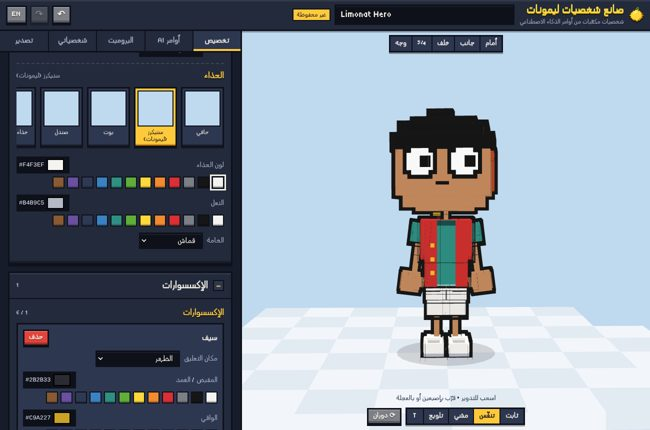

# صانع شخصيات ليمونات — Limonat Character Creator

Version 1.1.0 · 2026-10-21 · Voxel document 1.0 · Normal 3D document 1.0

A standalone app that builds 3D characters for Limonat from **JSON written by
any external AI model**, with **two independent creation modes**:

| Mode | What it makes |
|---|---|
| **Voxel** (مكعّبات) | Limonat's blocky voxel characters on a 20-bone rig — unchanged from 1.0 |
| **Normal 3D** (3D عادي) — new in 1.1 | smooth realistic or stylized characters: detailed face, sculpted hair with strands, clothes cut and fitted in layers, 55-bone rig, PBR materials |

You give an AI a picture plus the prompt of the mode you are in; the AI answers
with JSON that picks parts, shapes and colours from that mode's library; the
app validates it, builds the character, shows it in 3D, lets you fine-tune it
by hand, and exports a GLB model, metadata and files for the game. Each mode
has its own document format, prompt, library, saves and export; documents of
one mode are refused (with an offer to switch) by the other.

The AI never makes a 3D model. It only chooses from parts that exist.



**Switching modes:** the switch is at the top of the page, next to the logo
(**مكعّبات | 3D عادي**; ▦ / ● on phones). The choice is remembered; each mode
keeps its own character, undo history and saves.

---

## 1. Run it

| Way | How |
|---|---|
| Single file (easiest, works offline, phone or PC) | Open `dist/limonat-character-creator.html` in a browser. Nothing to install. |
| Source version | Serve this folder with any static server: `python3 -m http.server 8080`, then open `http://localhost:8080`. ES modules do not load from `file://`, so a server is needed for the source version only. |
| Published page | The same single file is published as a claude.ai page; saves there go to your Claude account. |

Requirements: a browser with WebGL (any current Chrome, Edge, Firefox or
Safari, desktop or Android/iOS). Three.js r158 is bundled in `vendor/`, so there
are no network requests.

## 2. The workflow (Voxel)

Normal 3D works the same way with its own tabs and prompt — see
[docs/N3D_OVERVIEW.md](docs/N3D_OVERVIEW.md) and
[docs/N3D_AI_WORKFLOW.md](docs/N3D_AI_WORKFLOW.md).

1. **Choose a base** — tab *Characters* → *New character from a base*
   (Limonat hero, Classic block human, Chibi).
2. **Copy the prompt** — tab *AI prompt* → *Copy full prompt*. It contains the
   rules, the schema and the full asset catalog.
3. **Ask any image-capable AI** (ChatGPT, Gemini, Claude, …): attach the
   reference picture, paste the prompt.
4. **Paste the reply** — tab *AI import* → paste → *Apply commands*.
   Every value is validated. Problems are listed in plain language with the
   field name and a suggestion. On any error nothing changes unless you press
   *Apply only the valid values*. Undo reverts an import.
5. **Fine-tune** — tab *Customize*: picker tiles (rendered on your character),
   colour pickers and palettes, materials, proportions, face details, accessories.
6. **Save** — tab *Characters* → *Save*. Name it in the top bar. Many designs
   can be kept, opened, duplicated, deleted and downloaded/opened as `.json`.
7. **Export** — tab *Export*: GLB, metadata JSON, Limonat JS, or all of them as
   a ZIP. *Re-open the exported file* loads the GLB back with a standard glTF
   loader and plays its walk clip, to prove the file works.

## 3. What is inside (Voxel)

Normal 3D: see [docs/N3D_OVERVIEW.md](docs/N3D_OVERVIEW.md) (30 hairstyles,
37 garments, 6 footwear, 22 accessories, 13 facial hair and 10 brow styles,
25 fabrics, 14 patterns, 11 body and 12 character presets, 29 body and 41
face controls, three detail levels).

| Area | Summary |
|---|---|
| Character | One rigged humanoid: 20 joints with VRM humanoid names (hips → spine → chest → neck → head, eyes, jaw; upper arm → lower arm → hand; upper leg → lower leg → foot). **Normal connected arms.** 12 attachment points for accessories. |
| Asset library | 86 parts in 14 slots: 2 body types, 3 head shapes, 11 hairstyles, 6 headwear, 6 eyes, 6 eyebrows, 6 mouths, 5 facial hair, 5 face details, 7 tops, 6 outerwear, 5 bottoms, 5 shoes, 13 accessories (glasses, headphones, scarf, necklace, badge, backpack, cape, belt, watch, sword, shield). |
| Customization | Shapes (different parts) **and** colours (main / secondary per part) **and** materials (cloth, denim, leather, glossy, metal, glowing) **and** 6 proportion sliders within safe limits. |
| AI command format | Versioned JSON (schema 1.0), documented in [docs/SCHEMA.md](docs/SCHEMA.md), with a JSON Schema in `schema/character.schema.json`. The same format is used for AI output, save files and export metadata. |
| AI prompt | Generated from the live asset registry, so it always lists exactly the parts that exist. Provider-neutral. Copy buttons for full prompt, prompt only, catalog. |
| Safety | AI output is data: parsed with `JSON.parse`, validated field by field, rendered with `textContent` only. Nothing is ever executed. |
| Export | GLB (skinned mesh, 20 bones, ink outline, materials, idle/walk/wave clips; arms-down or T-pose; −Z or +Z facing; flat or PBR shading), metadata JSON, `*.limonat.js` (a `VR.CHARACTERS` entry for the game), ZIP of everything. |
| Interface | Arabic (default) and English, phone and desktop layouts, Limonat's own UI style; pixel font for Latin, Changa / Kufam for Arabic (render correctly on iPhone). Undo/redo (Ctrl+Z / Ctrl+Shift+Z). |

## 4. Project layout

```
index.html              page shell (source version)
css/app.css             styles (Limonat UI system)
src/
  main.js               app wiring + mode host (Voxel / Normal 3D)
  n3d/                  the Normal 3D mode (own registry, pipeline, worker, renderer, schema, export, UI)
  core/                 constants, skeleton, body measurements, compiler, registry, document, colours, transforms
  assets/               the asset library (bodies, face, hair, clothing, accessories, bases)
  schema/               schema constants, validator, prompt / catalog / JSON Schema generators
  render/               Three.js: rigged mesh builder, viewer, poses + clips, thumbnails
  export/               GLB + metadata, Limonat script, ZIP, file saving
  storage/              saved-character library (account or browser)
  ui/                   panels, store (undo/redo), i18n, DOM helpers, mode switch
schema/                 character.schema.json, asset-catalog.json,
                        limonat-character-3d.schema.json, limonat-3d-asset-catalog.json (generated)
examples/               Voxel AI outputs and a saved character; examples/n3d/ Normal 3D examples and presets
integration/limonat/    Normal 3D runtime for the game (limonat-n3d.js) + GLTFLoader as a classic script
docs/                   documentation (see below)
dist/                   single-file builds
tests/unit/             Node tests for the pure modules (both modes)
tests/e2e/              browser acceptance tests (Playwright): app.test.mjs (Voxel), n3d.test.mjs (Normal 3D)
assets/                 site icons (the hero's voxel head)
tools/                  gen-schema.mjs, gen-n3d.mjs, build.mjs, build-integration.mjs, n3d-thumbs.mjs,
                        make-logo.mjs (logo + icons from the hero's head)
vendor/three/           Three.js r158 (MIT)
fonts/                  Tiny5 pixel font (Latin, as in the game) + Changa / Kufam (Arabic), SIL OFL
```

## 5. Documentation

| File | Contents |
|---|---|
| [docs/AI_WORKFLOW.md](docs/AI_WORKFLOW.md) | How to use an external AI model; how the model must write commands; fixing validation errors |
| [docs/SCHEMA.md](docs/SCHEMA.md) | The character document, field by field |
| [docs/ASSET_CATALOG.md](docs/ASSET_CATALOG.md) | Every asset id, colour, attachment point, material (generated) |
| [docs/AI_PROMPT.txt](docs/AI_PROMPT.txt) | The full prompt as the app produces it (generated) |
| [docs/ARCHITECTURE.md](docs/ARCHITECTURE.md) | Modules, coordinate system, skeleton, compiler, rendering, export |
| [docs/ADDING_ASSETS.md](docs/ADDING_ASSETS.md) | Adding hairstyles, clothes, accessories, bases and new commands |
| [docs/LIMONAT_INTEGRATION.md](docs/LIMONAT_INTEGRATION.md) | Putting characters in the game; path to the VTuber recording app |
| [docs/TEST_REPORT.md](docs/TEST_REPORT.md) | Voxel: what works, what was tested, what is left for later |
| [docs/N3D_OVERVIEW.md](docs/N3D_OVERVIEW.md) | Normal 3D: what it makes, the interface, detail levels, limits |
| [docs/N3D_AI_WORKFLOW.md](docs/N3D_AI_WORKFLOW.md) | Normal 3D: image → character with an external AI model |
| [docs/N3D_SCHEMA.md](docs/N3D_SCHEMA.md) | Normal 3D document `limonat-character-3d` and its validation |
| [docs/N3D_ASSET_CATALOG.md](docs/N3D_ASSET_CATALOG.md) | Normal 3D assets with their controls, colours and fabrics (generated) |
| [docs/N3D_AI_PROMPT.txt](docs/N3D_AI_PROMPT.txt) | The Normal 3D prompt as the app produces it (generated) |
| [docs/N3D_ARCHITECTURE.md](docs/N3D_ARCHITECTURE.md) | Normal 3D pipeline, modules, techniques, coordinates |
| [docs/N3D_ADDING_ASSETS.md](docs/N3D_ADDING_ASSETS.md) | Adding Normal 3D garments, hair, accessories, fabrics |
| [docs/N3D_LIMONAT_INTEGRATION.md](docs/N3D_LIMONAT_INTEGRATION.md) | Normal 3D characters in the game (runtime kit, costs) |
| [docs/N3D_TEST_REPORT.md](docs/N3D_TEST_REPORT.md) | Normal 3D: what was tested, results, limits |

## 6. Development

```bash
npm install            # esbuild, three, gltf-validator, gltf-transform, playwright (dev only)
npm test               # unit tests (Node)
npm run test:e2e       # browser acceptance tests (Voxel + Normal 3D) of the source version
npm run test:dist      # same tests against dist/limonat-character-creator.html
npm run thumbs         # Normal 3D picker thumbnails (after adding assets)
npm run build          # regenerate schemas/catalogs/prompts/examples (both modes), then rebuild dist/
node tools/build-integration.mjs   # rebuild integration/limonat/three-gltf-loader.js
```

After adding assets run `npm run build` so the generated docs and `dist/` match.
The app itself always builds the prompt and catalog live from the registry.

## 7. Licences

App code: MIT. Bundled: three.js (MIT), Tiny5, Changa and Kufam fonts (SIL Open
Font License 1.1, texts in `fonts/`).
