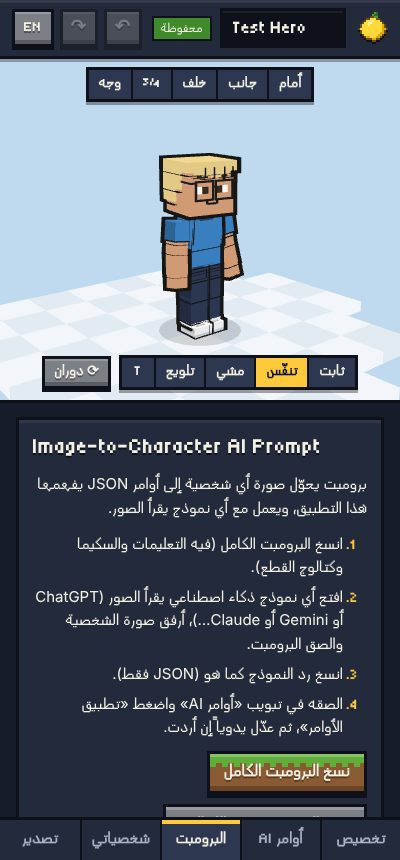

# Image → character with an external AI model

Version 1.0.0 · 2026-10-10

The creator has no AI built in. You can use any model that reads images
(ChatGPT, Gemini, Claude, Copilot, a local vision model…). The app supplies the
instructions; the model supplies JSON; the app checks and applies it.



## 1. Steps

1. In the app, open **AI prompt** and press **Copy full prompt**.
2. In the AI chat, attach the reference picture and paste the prompt.
   (A short line such as "Character: the girl on the left" helps when the
   image shows several people.)
3. Copy the model's whole reply.
4. In the app, open **AI import**, paste, press **Apply commands**.
5. Read the report. Fix by hand in **Customize**, or ask the model to correct
   the listed problems and paste again. **Undo** reverts an import.

| Button | Use it when |
|---|---|
| Copy full prompt | Normal case. Instructions + schema + the complete asset catalog + an example. About 28,000 characters. |
| Copy prompt without catalog | The chat already has the catalog (second image in the same chat), or the model has a small input limit. Then also send the catalog. |
| Copy asset catalog | To send the catalog separately. |
| Download catalog JSON / JSON Schema | For tools that accept a JSON Schema ("structured output", "response format") so the model is forced into the exact shape. |

## 2. What the prompt tells the model

The prompt is generated from the asset registry every time the app starts
(`src/schema/prompt.js`), so it always matches the parts that exist. It
tells the model to:

1. analyse only what is visible: hair, skin, eyes, brows, mouth, facial hair,
   face marks, hat, shirt, jacket, trousers, shoes, glasses, bags, weapons, build;
2. pick the closest **existing** asset id for each part, by shape first and colour second;
3. sample colours as `#RRGGBB` and keep proportions inside the listed ranges;
4. never invent ids, slots, properties or attachment points; fall back to the
   closest asset or the slot's `_none` asset;
5. follow the schema exactly;
6. answer with **only** the JSON object (no Markdown, no explanation);
7. not invent details that cannot be seen;
8. use sensible defaults for hidden parts and list each guess in `uncertain`;
9. list features no asset can show in `unsupported`, with the substitute used;
10. keep the character recognisable (signature hat, hair colour, outfit colours, scars, weapons first);

and that left / right means the character's own left / right.

The full text is in [AI_PROMPT.txt](AI_PROMPT.txt).

## 3. What a good answer looks like

```json
{
  "schemaVersion": "1.0",
  "mode": "replace",
  "baseCharacter": "base_classic_block",
  "reference": { "description": "Cheerful young pirate, straw hat, scar under the left eye, open red vest…", "source": "anime" },
  "character": {
    "name": "Straw Hat Pirate",
    "body": { "typeId": "body_block_01", "skinColor": "#E8B48A", "proportions": { "headScale": 1.12 } },
    "hair": { "assetId": "hair_spiky_01", "color": "#161616" },
    "face": {
      "eyes": { "styleId": "eyes_anime_01", "color": "#2A1A12", "gaze": "center" },
      "mouth": { "styleId": "mouth_grin_01" },
      "details": [{ "assetId": "detail_scar_cheek_01", "side": "left", "color": "#7A3030" }]
    },
    "headwear": { "assetId": "hat_straw_01", "color": "#E6C35C", "secondaryColor": "#C62E2E" },
    "clothing": {
      "top": { "assetId": "top_none" },
      "outerwear": { "assetId": "outer_vest_open_01", "color": "#C8282A", "secondaryColor": "#F2C230" },
      "bottom": { "assetId": "bottom_shorts_rolled_01", "color": "#3E6FB0", "material": "denim" },
      "shoes": { "assetId": "shoes_sandals_01" }
    }
  },
  "uncertain": [{ "field": "character.clothing.shoes", "note": "Feet are small in the image; sandals chosen." }],
  "unsupported": [{ "feature": "Yellow sash at the waist", "closestSubstitute": "acc_belt_01 coloured yellow" }]
}
```

More in `examples/` (`ai-output-pirate.json`, `ai-output-example.json`, a
`patch` example and an invalid example).

## 4. The app accepts common slips

| The model did | The app |
|---|---|
| Wrapped the JSON in ```` ```json ```` fences | Removes them (warning). |
| Added a sentence before / after the JSON | Ignores it (warning). |
| Used curly quotes or trailing commas | Repairs them (warning). |
| Wrote `assetId` where `styleId` is expected (or the reverse) | Accepts it (warning). |
| Gave a number outside the safe range | Clamps it (warning). |
| Gave an attachment point the accessory does not support | Uses the default point (warning). |
| Added a property that does not exist | Ignores it (warning). |

These are **errors** (the import stops, the character stays as it was):
invalid JSON, an id that does not exist or belongs to another slot, a colour
that is not hex, a non-number proportion, a missing `character`, a schema major
version other than 1. You can still press **Apply only the valid values**.

## 5. Asking the model to fix errors

Copy the error lines from the report and send them back:

> These ids were rejected: "hair_spikey_01" (did you mean hair_spiky_01?),
> "top_hawaiian_99". Use only ids from the catalog and reply with the corrected
> JSON only.

## 6. Modes

| Mode | Result |
|---|---|
| `replace` (default) | A new character: start from `baseCharacter` (or the current base), apply the document. Gets a new id, so saving does not overwrite a different saved character. |
| `patch` | Changes only the fields given, on the character that is open (same id). Example: `{"schemaVersion":"1.0","mode":"patch","character":{"hair":{"color":"#E9D08A"}}}`. |

The *Apply as* menu in the import tab can force either mode.

## 7. Tips per provider

* Any model: put the image **and** the prompt in the same message.
* If the model starts explaining, reply "JSON only".
* Models that support a JSON Schema or "structured output" give the most
  reliable results: upload `schema/character.schema.json`
  (*AI prompt → Download JSON Schema*). Its enums list every valid id.
* Very small or local models may skip the catalog; use the full prompt and
  expect more warnings.
