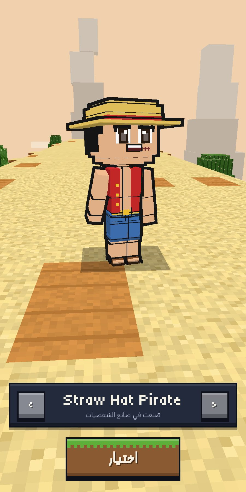

# Using creator characters in Limonat (and the future recording app)

Version 1.0.0 · 2026-10-10 · checked against Limonat v1.39 (`limonatkhi`, commit 2949956)

## 1. What the game expects

Limonat characters are entries of `VR.CHARACTERS` (`js/character.js`):

```js
{ id, name: { en, ar }, tagline: { en, ar },
  model: { legL, legR, body, head, armL, armR },   // each { pivot: [x,y,z], boxes: [[x,y,z,w,h,d,'colour'], …] }
  palette: { colour: 0xRRGGBB, … }, outline: 0.32, noOutline: ['ink', …],
  fpArms: { armL: [...boxes], armR: [...boxes] } }  // optional, first-person hands
```

Units are px (`VR.CHARACTER_PX` = 0.084 m), −Z is the front, +X the
character's right. `VR.buildCharacter(def)` turns an entry into a rig; the
runner, missions, duels and mini-games all use that function, and the
Character menu lists every entry.

The creator uses the same units, axes, outline width, ink colour and shading,
so a creator character is a native Limonat character.

## 2. Path A — drop-in script (works today)

Export → **Download Limonat JS** (or the ZIP) gives `<name>.limonat.js`.

1. Copy it to `js/characters/` in the game.
2. In `index.html`, right **after** `<script src="js/character.js"></script>`, add:
   ```html
   <script src="js/characters/straw-hat-pirate.limonat.js"></script>
   ```
3. Open the Character menu: the new character is in the list.

The script adds the entry (or replaces an older export with the same id
`cc_<name>`). It contains no game logic and can be removed at any time.

Tested: an exported "Straw Hat Pirate" was added to an unmodified copy of
Limonat v1.39; it appears in the Character menu and renders with outline, no
console errors.



How the 20-joint skeleton maps to the game's 6 animated parts:

| Creator joints | Limonat part (pivot) |
|---|---|
| hips, spine, chest, neck | `body` (hips) |
| head, leftEye, rightEye, jaw | `head` (head) |
| leftUpperArm, leftLowerArm, leftHand | `armL` (shoulder) |
| rightUpperArm, rightLowerArm, rightHand | `armR` (shoulder) |
| leftUpperLeg, leftLowerLeg, leftFoot | `legL` (hip) |
| rightUpperLeg, rightLowerLeg, rightFoot | `legR` (hip) |

The game animates whole limbs from the shoulder and hip, so elbows and knees
stay straight there; no voxel is lost (a unit test counts them). The script
also includes `fpArms` (forearm + hand) for the first-person view, like
Mr. Fridge. Two-player tones (`VR.toneCharacter`) work as for built-in characters.

The game's own hero keeps its floating hands; creator characters always have
connected arms.

## 3. Path B — player-created avatars (recommended next step)

For players making their own characters in the game, ship the **character
document** (`*.character.json`, about 2 KB) instead of models:

* `src/core`, `src/assets` and `src/schema` are plain JavaScript with no
  browser or Three.js dependency. `src/game-entry.js` bundles them for the
  game's classic scripts (about 135 KB, tested as a classic script):
  ```bash
  npx esbuild src/game-entry.js --bundle --format=iife --global-name=LimonatCC --outfile=lib/limonat-cc.js
  ```
* In the game, after `js/character.js`:
  ```js
  const r = LimonatCC.validateDocument(json);   // untrusted JSON → checked config (+ report)
  if (r.config) VR.CHARACTERS.push(LimonatCC.toLimonatCharacter(r.config, 'player_1'));
  ```
  The entry works with `VR.buildCharacter` like any built-in character.
* Multiplayer (MQTT, `docs/MULTIPLAYER.md` in the game) can send the JSON
  document instead of a character id: other players rebuild the same avatar
  locally, and the validator protects them from bad data.
* The creator UI itself can be embedded later as an in-game screen; it only
  needs a container element and the store.

## 4. Path C — the GLB

The GLB is for tools and engines (Blender, Unity, Godot, online viewers) and
for a future switch of the game to bone animation. The game currently loads
`lib/three.min.js` (classic build, no `GLTFLoader`), so using GLBs inside the
game would need the ES-module build of Three.js or a vendored loader, and the
player animation code would rotate bones (`leftUpperArm`, `leftLowerArm` …)
instead of the 6 part pivots. The GLB's joint names, attachment empties and
`extras` are designed for that, but nothing in the game has to change today.

| Export option | Use for |
|---|---|
| Arms down, −Z, flat | Matches the game exactly (default). |
| T-pose, +Z, PBR | Blender / Unity humanoid import, Mixamo-style retargeting, VRM tools. |

## 5. The future Voxel VTuber recording app

The character is already prepared for body tracking; nothing of the recording
app is built yet.

| Need | Already in place |
|---|---|
| Standard humanoid rig | 20 joints with **VRM humanoid names**; webcam trackers (MediaPipe → VRM retargeting) map 1:1. |
| Neutral pose for retargeting | T-pose export with identity bone rotations. |
| Face | Separate `leftEye`, `rightEye` and `jaw` joints for blinking, gaze and talking. |
| Props | Attachment empties (`attach_hand_right`, `attach_head_top`, …). |
| One format | The same `character.json` drives the creator, the game and the recording app; no second character format. |
| Mid-torso "gamer cam" framing | Head, chest and arms are separate rigid parts, so a crop from the chest up looks complete. |

Suggested later steps: write a `VRMC_vrm` extension into the GLB (the bone map
is the joint list itself), add blend-shape-free expressions by swapping face
assets per frame (eyes → `eyes_happy_01`, mouth → `mouth_open_01`), and reuse
`src/render/mesh.js` for the live avatar.
